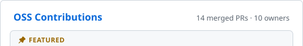
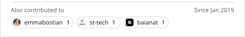
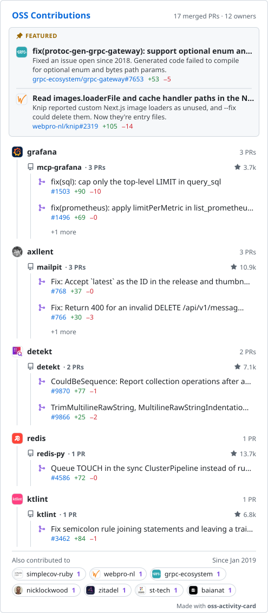

### OSS Contributions (linked, one image per row)

<!-- oss-card:start -->

<picture><source media="(prefers-color-scheme: dark)" srcset="oss-card/01-dark.svg"></picture> 
<a href="https://github.com/axllent" title="axllent: 3 PRs"><picture><source media="(prefers-color-scheme: dark)" srcset="oss-card/02-dark.svg"></picture></a> 
<a href="https://github.com/axllent/mailpit" title="axllent/mailpit: 10.9k stars, 3 PRs"><picture><source media="(prefers-color-scheme: dark)" srcset="oss-card/03-dark.svg"></picture></a> 
<a href="https://github.com/axllent/mailpit/pull/768" title="axllent/mailpit#768: Fix: Accept `latest` as the ID in the release and thumbnail endpoints"><picture><source media="(prefers-color-scheme: dark)" srcset="oss-card/04-dark.svg"></picture></a> 
<a href="https://github.com/axllent/mailpit/pull/766" title="axllent/mailpit#766: Fix: Return 400 for an invalid DELETE /api/v1/messages body"><picture><source media="(prefers-color-scheme: dark)" srcset="oss-card/05-dark.svg"></picture></a> 
<picture><source media="(prefers-color-scheme: dark)" srcset="oss-card/06-dark.svg"></picture> 
<a href="https://github.com/detekt" title="detekt: 1 PR"><picture><source media="(prefers-color-scheme: dark)" srcset="oss-card/07-dark.svg"></picture></a> 
<a href="https://github.com/detekt/detekt" title="detekt/detekt: 7.1k stars, 1 PR"><picture><source media="(prefers-color-scheme: dark)" srcset="oss-card/08-dark.svg"></picture></a> 
<a href="https://github.com/detekt/detekt/pull/9866" title="detekt/detekt#9866: TrimMultilineRawString, MultilineRawStringIndentation: Report multi-dollar raw strings"><picture><source media="(prefers-color-scheme: dark)" srcset="oss-card/09-dark.svg"></picture></a> 
<a href="https://github.com/grafana" title="grafana: 2 PRs"><picture><source media="(prefers-color-scheme: dark)" srcset="oss-card/10-dark.svg"></picture></a> 
<a href="https://github.com/grafana/mcp-grafana" title="grafana/mcp-grafana: 3.6k stars, 2 PRs"><picture><source media="(prefers-color-scheme: dark)" srcset="oss-card/11-dark.svg"></picture></a> 
<a href="https://github.com/grafana/mcp-grafana/pull/1496" title="grafana/mcp-grafana#1496: fix(prometheus): apply limitPerMetric in list_prometheus_metric_metadata"><picture><source media="(prefers-color-scheme: dark)" srcset="oss-card/12-dark.svg"></picture></a> 
<a href="https://github.com/grafana/mcp-grafana/pull/1467" title="grafana/mcp-grafana#1467: fix(dashboard): describe list_dashboard_versions start as an offset"><picture><source media="(prefers-color-scheme: dark)" srcset="oss-card/13-dark.svg"></picture></a> 
<a href="https://github.com/nicklockwood" title="nicklockwood: 1 PR"><picture><source media="(prefers-color-scheme: dark)" srcset="oss-card/14-dark.svg"></picture></a> 
<a href="https://github.com/nicklockwood/SwiftFormat" title="nicklockwood/SwiftFormat: 9k stars, 1 PR"><picture><source media="(prefers-color-scheme: dark)" srcset="oss-card/15-dark.svg"></picture></a> 
<a href="https://github.com/nicklockwood/SwiftFormat/pull/2877" title="nicklockwood/SwiftFormat#2877: Fix tokenizer error for enums with value generic parameters"><picture><source media="(prefers-color-scheme: dark)" srcset="oss-card/16-dark.svg"></picture></a> 
<a href="https://github.com/zitadel" title="zitadel: 1 PR"><picture><source media="(prefers-color-scheme: dark)" srcset="oss-card/17-dark.svg"></picture></a> 
<a href="https://github.com/zitadel/zitadel" title="zitadel/zitadel: 15.5k stars, 1 PR"><picture><source media="(prefers-color-scheme: dark)" srcset="oss-card/18-dark.svg"></picture></a> 
<a href="https://github.com/zitadel/zitadel/pull/10811" title="zitadel/zitadel#10811: feat(login): add Japanese localization for login frontend app"><picture><source media="(prefers-color-scheme: dark)" srcset="oss-card/19-dark.svg"></picture></a> 
<picture><source media="(prefers-color-scheme: dark)" srcset="oss-card/20-dark.svg"></picture>

<!-- oss-card:end -->

### OSS Contributions (single image, for comparison)

<picture>
  <source media="(prefers-color-scheme: dark)" srcset="./oss-card-dark.svg">
  
</picture>
